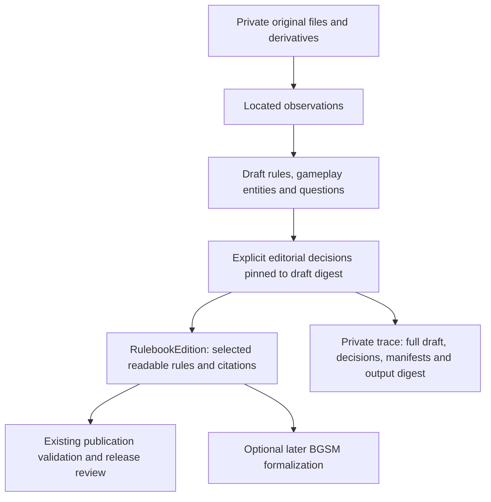

# Draft game knowledge contract 0.1.0

This contract connects research tools to RuleBooks' reviewed rules. It supplements the [reference artifact handoff](../development/reference-handoff.md) and [publication contract](publication-contract.md); it does not change publication schema 0.1.0 or define executable BGSM. Start with the [producer guide](../development/game-knowledge-producer.md) for what a tool should emit. The normative shape is [knowledge.schema.json](../../schema/knowledge/0.1.0/knowledge.schema.json); relational checks and projection live in [validate_knowledge.py](../../tools/validate_knowledge.py).

This is an optional path for draft findings. Producers with an existing editorial process may supply already-reviewed publication records directly; they need not reconstruct a draft, repeat review here or use the private reference store. The editor role can belong to the producer's process. All paths converge on the public data contract and release validation.



## Records and ownership

| Record | Owner | Required content and relationships |
|---|---|---|
| `GameKnowledgeDraft` | Producer | Stable draft ID/revision, game identity, profile/scope, sources, processing runs, evidence, proposed rules, questions and topic coverage; optional gameplay entities |
| Draft source | Producer | Document/playthrough/editorial identity and document edition or explicit unknown; acquired sources reference named handoff artifacts; editorial sources name original-definition attribution |
| Evidence | Producer | Source, selected artifact where applicable, page/section/time/byte locator, observation and generating run |
| Proposed rule | Producer | Statement, topic, dimension, explicit/inferred/editorial basis, generating run and support; inferred rules add rationale and optional premise links |
| Gameplay entity | Producer, optional | Named player/component/space/resource/phase/action/outcome, description and rule support; optional action actors and condition/effect rule links |
| Question | Producer | Kind, affected rules/evidence, text and whether it blocks publication, completeness or neither |
| `GameKnowledgeReview` | Accountable editor | Exact draft ID/revision/digest, target edition metadata, ordered sections, reviewed Source mappings, one decision per proposed rule/question and accepted review metadata |
| `KnowledgePromotionTrace` | Projector | Full exact draft, review, evidence manifests and public Source records, plus generated edition digest; retained privately |
| `RulebookEdition` | Existing publication model | Reviewed statements, stable public rule IDs, public citations/editorial attribution, scope and reading status; no raw acquisition details |

These nested records avoid requiring a distributed database or a separate file for every observation. A submission is a snapshot for one game/profile; sources and observations can support many claims within it. Several acquisition artifacts may belong to the same source. Draft gameplay entities organize research and do not claim to be BGSM Concepts.

## Editorial decisions are a separate contract

A producer cannot make a rule publishable by adding a confidence score or asserting `accepted`. The editor creates `GameKnowledgeReview` after examining its pinned draft, source records and evidence:

1. Choose the target RulebookEdition identity/revision, scope and reading status. Publisher edition remains part of the game identity; target revision is RuleBooks' editorial revision.
2. Supply a decision for **every** proposed rule: `accept`, `reject` or `defer`, with a reason. Acceptance specifies the public section and exact output rule ID, statement and origin. Rewording is allowed and explicit; the original text remains in the trace.
3. Supply a decision for **every** question: `resolved` with a reason and any relevant evidence IDs, or `deferred` with a reason and public scope limitation. Resolution is an editorial assertion, not a proven fact. Adding new research evidence requires a new draft revision first.
4. Map supporting non-editorial source IDs to exact, separately reviewed public Source revisions. Document editions must match. Accepted rules retain all externally supporting source pins, including support inherited through inference premises. The editor chooses accurate public citation locators and verifies source authority/applicability.
5. Record authors, responsible human, reviewer and timestamp using the existing review shape. Its `reviewedDigest` covers the entire review object except its top-level `review`, thereby binding the selected output, decisions, source mappings and exact draft pin.

Rejected and deferred proposals never enter the generated edition, but their observations, inference rationale and decisions remain in the trace. Contradicting evidence must have a conflict question even if the proposed rule is ultimately rejected. The projector rejects missing/duplicate decisions, dangling references, cyclic inference, mismatched source editions and changed reviewed bytes.

An accepted inference cannot depend on a rejected/deferred premise. One accepted proposal maps to one public rule in 0.1.0. Split or consolidate claims in a new producer draft before review when a many-to-many mapping is needed; do not smuggle unrelated new rules into an editorial rewording. Machine checks bind the text, but a reviewer must judge whether a rewording preserves meaning.

## Open questions and completeness

A deferred publication-blocking question prevents acceptance of affected rules; an empty affected-rule list means the whole profile. A deferred completeness-blocking question prevents `readingStatus: complete`. Every deferred question, including nonblocking ones, requires a `publicNote` appearing verbatim in the target scope's exclusions. This produces a readable limitation without exporting private research material.

Complete reading status additionally requires every topic to be described or explicitly outside scope and every rule in described topics to be accepted. A rejected speculation remains part of the current draft inventory, so the next clean draft must remove/revise it before that topic supports a completeness claim. Prior draft and trace retention preserves why it was removed. An editor cannot turn missing research into a complete game by checking an approval box. Scope boundaries and the adequacy of the topic inventory still need human judgment.

In the examples, chess remains partial because special moves and other mechanics are uncollected. Nim is complete only for the authored `[1, 2]` normal-play configuration. RPS preserves the rejected replay inference and therefore remains partial in its first projection; a subsequent reviewed draft can describe the selected one-round profile completely. None of these labels asserts semantic mapping or executable verification.

## Projection, preservation and publication

After source metadata promotion and review, prepare an edition in a **new private output directory**:

```sh
python3 tools/validate_knowledge.py project \
  --draft "$PRIVATE_DRAFT" \
  --review "$PRIVATE_KNOWLEDGE_REVIEW" \
  --handoff "$PRIVATE_REFERENCE_HANDOFF" \
  --source "$REVIEWED_PUBLIC_SOURCE_JSON" \
  --output-dir "$NEW_PRIVATE_PROJECTION_DIRECTORY"
```

Repeat `--source` for reviewed Source envelopes from reference promotion and `--handoff` for evidence manifests. Editorial-only definitions need neither. Supply `--previous` when checking a later draft against its trusted predecessor. On a filesystem governed by server ACLs rather than enforceable POSIX modes, `--accept-server-access-controls` explicitly confirms those restrictions for the output location. Existing directories are never overwritten. Output paths must be outside Git and the managed reference store.

The projector writes:

- **`edition.json`**: a candidate RulebookEdition conforming to publication schema 0.1.0, with a review digest derived from the approved output;
- **`trace.json`**: the full private `KnowledgePromotionTrace`, sufficient to regenerate the exact edition and retain rejected claims and unresolved questions. `verify_trace()` recomputes it and detects divergence.

The projection contains no automatic source fetching, public write, Git commit or release. Review names and digests are **not authenticated signatures**. Source envelopes and the knowledge review require the future trusted editorial approval workflow; a CLI flag or self-authored review cannot establish authority. Public-source content screening and human confidentiality review remain required.

Keep the draft, reviews, handoffs, capture receipts, original evidence and promotion trace in durable private storage with backup and retention. The trace includes metadata/manifests, not source-file bytes or importer receipts; it does not replace the reference store or its backup. `editionDigest` is the join from a published edition back to its private trace. Public readers retain source citations and scope limitations; private inference history is not silently placed on the public site. A richer public adjudication/evidence view will need an explicit, separately reviewed projection.

Only the candidate edition and its approved public dependencies proceed to the existing publication assembler/release checks. That stage must supply the Game, exact Source revisions, historical edition lineage and publication manifest. The knowledge projector checks an individual edition, not a complete release or authenticated approval. Publication validation remains mandatory. No catalog entries, work queue completions or semantic gaps are created by these examples.

## Versioning and implementation limits

The schema, research draft revision, publisher edition, source edition, editorial review revision, published rulebook revision and eventual BGSM release are independent. Schema readers are closed: new fields require a new schema version. Revision 2+ drafts require a predecessor pin; `--previous` checks it against supplied trusted bytes. Without that argument, the tool checks the pin's shape but cannot establish historical authenticity. Reviews/traces are immutable snapshots by policy and must not be overwritten at the same identity; storage/index enforcement across all research versions remains future work.

This version supports readable gameplay claims, optional entity/action organization, multiple source artifacts, located evidence, inference dependencies, conflict/question handling and deterministic editorial projection. It does not implement automatic source reconciliation, calibrated confidence, authenticated reviewers, a draft database/editor UI, video understanding, executable BGSM or a generic game engine. Handoff binding checks metadata, while reference intake verifies bytes; neither establishes that the evidence actually proves the rule.

The CLI validates local JSON only and prints counts/digests rather than source content. Repository checks exercise the three synthetic examples and reject top-level draft/review/trace records outside the test-fixture area. Actual research is not a build dependency. Tests cover the accepted projection against the existing publication validator as well as dropped provenance, unresolved blockers, altered evidence/reviews and private-output boundaries.
