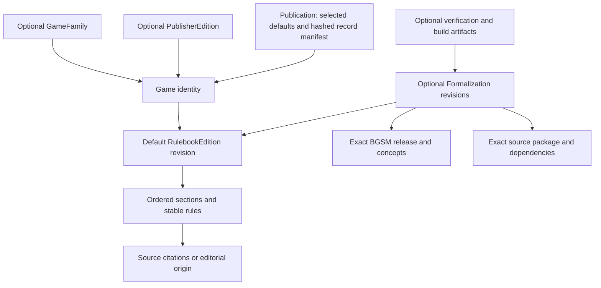

# Game publication contract 0.1.0

This implements the [selected data model](../product/data-and-versioning.md) and [engineering issue #1](https://github.com/miralie-llc/rulebooks/issues/1). The normative shape is [JSON Schema Draft 2020-12](../../schema/publication/0.1.0/bundle.schema.json); the [validator](../../tools/validate_publication.py) adds reference, coverage, integrity and history checks. This is the first contract to exercise with real collection, not a released BGSM or an implemented game language.

## Start with a game and its readable rules



A readable-only game needs a Game and RulebookEdition, plus Sources when externally sourced. It needs no empty formalization, model, package or evidence fields. Original definitions can use an editorial origin instead of an invented source. A rule inherits the edition's origin unless it declares its own. Each rule must have an effective attribution.

Game IDs identify the game, including a distinct publisher edition where one exists. Rulebook IDs identify our editorial profiles; their positive integer revisions identify immutable snapshots. A game may have several profiles and revisions. `Game.defaultEdition` selects one exact profile revision, and `publication.games` selects one exact Game revision for each discovery entry. Changing that default creates a new Game metadata revision without creating a new game identity.

The bundle is an exchange and validation boundary, not a requirement to edit a giant JSON file. Records can be authored separately; the assembler in issue #4 will gather them into a closed, reproducible publication. There is no assembler or public catalog in this change. Current bundles live only in test fixtures. Never copy a checkout or the test fixtures into site output.

### Boundary with acquisition and inferred rules

This is a reviewed publication contract, not a draft submission schema. `RulebookEdition` requires accepted review; acquisition tools must not fabricate that review to submit their findings. The separate [reference handoff](../development/reference-handoff.md) imports original files and derivatives. The [draft game-knowledge contract](draft-game-knowledge.md) represents tools' proposed rules, evidence, gameplay structure and unresolved questions before editorial approval.

Its reviewed projection explicitly maps accepted proposals into edition rule IDs and preserves the full draft and editorial decisions in a private trace bound to the generated edition digest. The current public `origin`/`citation` fields retain attribution; scope exclusions disclose deferred questions without exporting private research. Formalization and package records below provide versioned relationships; they are not themselves an implemented semantic language. A generated edition still requires complete publication assembly, trusted approval and release validation.

## What the first three games teach the contract

| Work-list game | Concrete test scope | Contract consequence |
|---|---|---|
| Chess | A short mechanics excerpt attributed to the FIDE Laws effective 1 January 2023; alternating play, checkmate, king safety and stalemate | `readingStatus: partial`, no formalization. The source edition is not a publisher edition of chess. A sourced excerpt must not be presented as a complete rules guide. |
| Normal-play Nim | Two visible heaps initially `[1, 2]`, A starts, remove a positive number from one heap, last counter wins | Six readable rules with stable IDs. A fictional package maps every rule, testing complete edition coverage without claiming execution or coverage of every Nim configuration. |
| Rock-paper-scissors | One round, concealed irrevocable choices, reveal after both commit, ties end the round | Only dominance and ties have fixture mappings. Choices, commitment, reveal and ending remain explicit unrepresented rows. A result table cannot stand in for the whole game. |

Read [the fixture guide](../../tests/fixtures/publication/README.md) alongside [first-games.json](../../tests/fixtures/publication/first-games.json). All reviews, semantic definitions and release identifiers in these fixtures are fictional. The package files explicitly are not a GDL. These examples do not complete the three content work items or establish any semantic gap. Chess still needs collection and review of the full selected scope. Nim and RPS use original fixture configurations, not claims of externally authoritative editions.

None of these games needs an invented publisher. A separate fictional publisher fixture demonstrates two publisher editions as two Games within one family, while an editorial correction advances the first edition's RuleBooks revision from 1 to 2. Its original rule text and publisher identity stay unchanged. Dominion's identity distinction from the product plan is preserved without fabricating collected Dominion records.

## Required fields and relationships

All records have `kind`, `id` and positive integer `revision`, except BGSMRelease, which has `kind` and an exact `version`. A pin is `{ "id": "...", "revision": 1 }`; its field determines the target record kind. BGSM references are exact version strings. Unknown fields are rejected. Optional fields are omitted when unused.

| Record | Additional required fields | Optional relationships and details |
|---|---|---|
| GameFamily | `title` | Discovery grouping only; no executable meaning |
| Game | `title`, `defaultEdition` | `family`, `publisherEdition`, `aliases`, `tags`; compact serialized record must fit 20 KiB |
| PublisherEdition | `gameId`, `issuer`, `label`, identifying Source citation | `released`, `externalId`, `predecessor`; each identity belongs to one Game, reciprocated by that Game |
| Source | `title`, `edition` label or explicit unknown, `url`, `accessed`, `reuse` | `author`; `permissionNote` required for `permission-recorded`. `metadata-only` grants no right to distribute captures. |
| RulebookEdition | `gameId`, `label`, `scope`, `dimensions`, `readingStatus`, ordered `sections`, `review` | Default `origin`; revision 2+ requires `previous` and `change` (`editorial` or `rules` plus summary). A lineage cannot move to another game. |
| Concept | `title`, `meaning`, `category`, `laws`, `examples`, `status` | Meaning is pinned by concept revision; this record does not itself implement an operation. |
| BGSMRelease | `status`, exact `concepts` and `libraries`, `capabilities`, `conformance` package, `changelog`, `breaking`, `review` | Exact `previous` version; `migration` required when `breaking` is true |
| DefinitionPackage | Exact `language` and `bgsm`, source `files` and hashes, exact `dependencies`, named `exports` | Empty dependencies are valid. Exports identify a declared file; imported packages must use the same BGSM and language version in 0.1.0. |
| Formalization | Exact `edition`, `bgsm`, `language`, `package`, exported `entry`, `scope`, per-rule `coverage`, `review` | Coverage rows can link exact Concepts from that BGSM release. Different formalizations can map the same readable edition to different releases. |
| VerificationRecord | Exact `formalization`, its `subjectDigest`, `implementation` version/build digest, hashed `suite`, `method`, `scope`, `result`, run time/URL | `bounds` required for bounded exhaustive checks; optional hashed `report`. Pass, fail and unknown are all valid records. |
| BuildArtifact | Exact `formalization`, its `inputDigest`, `compiler` version/build digest, hashed `output`, `sourceMap` | An export adds `target` language/version, runtime build, supported subset and behavior mappings. |

A section requires an ID, title and ordered rules. A rule requires an ID and readable statement; IDs must be unique across its edition. Scope requires a summary, explicit inclusions and exclusions. Dimensions identify reusable rules about the game, players, events, tournaments or composition; they do not introduce instances of events or playthroughs. Inheritance/variant patch semantics are deferred until supported, rather than guessed here.

Formalizations are separate records pointing to editions. Verification and artifacts point to formalizations. This keeps readable records small and avoids circular lists of optional children. Reverse links are derived. Neither a GameFamily nor an authority's publication date becomes an executable game identity.

SemanticGap remains owned by the existing `work/` contract. No parallel gap entity or speculative work item is introduced. Coverage can explain an omission without asserting that it is a language defect. Public gap projections can be added when evidenced gaps actually exist.

## Coverage, reading and verification stay separate

A formalization must account for **every rule in its pinned edition exactly once**:

| Status | Required explanation |
|---|---|
| `represented` | One or more exported definition links in the package's dependency closure |
| `partial` | Definition links and a reason explaining the missing part |
| `unrepresented` | A reason; no definition links |
| `outside-declared-scope` | A reason also present in the formalization's scope exclusions; no definition links |

Complete edition coverage is derived only when every row is represented. Outside-scope rows do not disappear from the denominator. No editable completeness badge or percentage is stored. Complete coverage of an incomplete reading excerpt still does not describe a complete game. Reading status is an independent editorial claim, and a complete mapping is not executable evidence.

An absent Formalization means not yet formalized. An absent VerificationRecord means no recorded verification, even if all rules are mapped. Structural checks are not scenario tests, exhaustive execution or proof. Results retain their method and scope/bounds. A failed verification blocks recommendation of that formalization while leaving the readable edition available. Future corrected behavior uses a new formalization revision and new evidence.

The validator checks consistency of these declarations. Only a qualified review can establish that the prose is accurate, the mappings mean what they claim, or the execution evidence is trustworthy. It neither executes package files nor infers capabilities from names.

## Publication, review and integrity

A bundle requires `schemaVersion`, `purpose`, `records` and `publication`. The publication object requires:

- `id`, source `repository` and exact `commit`, `releasedAt`, accountable human `owner`, and release `notes`;
- a `manifest` containing exactly every record pin and its SHA-256;
- `games`, selecting exact Game revisions;
- a `review` of the publication payload.

Optional `recommendedFormalizations` select at most one mapping per edition. Optional `previous` pins the prior publication by release ID and digest; `withdrawals` retain the removed record's pin, hash and reason. They do not permit dangling active references. Defaults and recommendations remain explicit selections, separate from historical records.

Review requires named authors with human/agent type, responsible human, reviewer, timestamp, accepted decision and `reviewedDigest`. Self-review is representable by using the same name; the record must not suggest independence that did not occur. A digest binds a review to bytes, but it is **not a signature or authenticated approval**. The later editorial/release workflow must establish who may approve and publish.

Contract 0.1.0 uses SHA-256 over sorted-key JSON serialized as compact UTF-8, with no ASCII escaping, no whitespace separators and no trailing newline. Array order is retained; strings are not Unicode-normalized. The schema admits integer revisions and no floating-point fields. Duplicate JSON keys and non-finite numbers are rejected. This is a defined project encoding, not a claim to implement RFC 8785. `digest()` is the reference implementation and fixtures provide known inputs and expected hashes.

For review hashes, exclude only the record's top-level `review`; the manifest hashes the complete record including review. Publication review hashes its complete payload except its own review. The publication is outside its manifest, avoiding a self-hash. File hashes cover raw bytes. Verification/artifact input digests identify the complete Formalization record; its exact package and model pins resolve through the manifest to hashed records and source files. Old revision keys cannot be reused with different content.

Files must resolve beneath the bundle directory, including after symlink resolution. Validation uses only local bundled files; source URLs and schema IDs are identifiers, never build-time fetches. Private research stores are not dependencies. A caller checking a new release supplies a trusted, previously validated bundle through `--previous`; the validator rejects changed immutable records, omitted history without withdrawal notices, reuse of the immediately previous release ID, and missing historical notices. The assembler/release workflow must supply that trusted baseline and enforce globally unique release IDs; a first isolated bundle cannot prove facts about prior releases.

The schema itself is versioned independently of these records. A bundle retains its schema version context; don't export bare fragments and assume readers can infer their contract. The future assembler can select a physical file/download layout without changing game identities.

## Compatibility and what comes next

`schemaVersion: 0.1.0` is exact. Required fields, interpretation changes or relaxed invariants that change accepted meaning need a new contract version and explicit migration. Closed schemas also reject newly added optional fields: such fields need a version bump and an updated reader, even if older data remains valid. Never describe a new field as transparently compatible with this strict reader. Published schemas and records stay available; version support can expand without rewriting historical bundles.

Publisher edition labels are external strings. RuleBooks revisions are positive counters. BGSM, package language and implementation versions are independent exact version strings with optional prerelease labels; ranges, `latest`, wildcards and aliases are not accepted. Package revisions are independently pinned. Runtime build digests are separate from semantic versions. Changing any of these does not automatically migrate other games.

Issue #4 adds deterministic assembly and release artifacts. Later issues add real semantic tooling, compilation and executable conformance evidence. Issue #11 implements trusted editorial approvals and migrations. Before production collection, apply the [license and source policy](../product/repository-boundaries.md#license-scope), complete source review and use actual reviewer identities. Fixture validation is not publication approval.

## Run the checks

```sh
python3 -m pip install -r tools/requirements-ci.txt
python3 tools/validate_work.py
python3 -m unittest discover -s tests -v
python3 tools/validate_publication.py tests/fixtures/publication/first-games.json --allow-fixtures
python3 tools/validate_publication.py tests/fixtures/publication/publisher-editions.json --allow-fixtures
```

For actual publication inputs, omit `--allow-fixtures`; pass `--previous path/to/prior-bundle.json` after the first release. Fixture bundles require an explicit opt-in and every fixture record carries `testOnly: true`. Relabeling the outer bundle alone cannot promote fixtures. JSON Schema alone checks shape; run the Python validator as well for the relationship and integrity contract.
