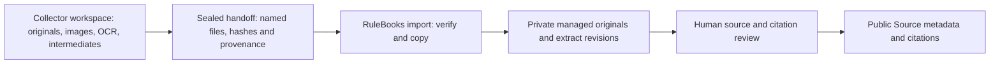

# Companion reference workflow handoff 0.1.0

The collection workflow and RuleBooks own **different storage roots**. The collector owns discovery, downloads, page images, OCR, intermediate data, processing status and retries. RuleBooks owns immutable captures/extract revisions, editorial source review and public promotion. Physical locations are private configuration; sibling roots are preferable when the collector recursively scans its tree. A dedicated child root also works if explicitly excluded from discovery and processing. The collector must not write inside the managed RuleBooks store.

The interface is a sealed `reference-handoff` manifest. Its authoritative schema is [`handoff` in reference contract 0.1.0](../../schema/reference/0.1.0/records.schema.json). The collector does not need to produce RuleBooks' internal content-addressed layout, a semantic definition or a public Source record.

## Scope: reference artifacts, not extracted game knowledge

This contract transfers evidence files and extraction provenance. It does **not** define the rules a tool has learned from those files. Structured JSON in a derivative is stored as opaque bytes; successful import does not validate its game knowledge.

The existing [publication contract](../architecture/publication-contract.md) defines reviewed readable rules through `RulebookEdition.sections[].rules[]`: stable rule IDs, statements and source citations. It also defines records linking those rules to optional formalization packages. It does not yet define an executable BGSM language.

A companion workflow that reads PDFs or playthroughs and infers how a game works should produce the separate **[draft game-knowledge contract 0.1.0](game-knowledge-producer.md)**. Its schema, validator and reviewed projection now represent proposed rules and gameplay structure, rule-level evidence, explicit inference versus source assertions, scope/edition uncertainty, conflicting accounts and unresolved questions. The draft references named artifacts from this handoff. Do not put the draft itself in an opaque derivative and assume its knowledge has been validated.

Playthroughs can supply private research evidence for a proposed rule. This does not introduce a public playthrough catalog or make an observed move authoritative evidence of every legal move. The flow is evidence artifacts → draft game knowledge → reviewed rulebook → optional formalization. The first three stages have initial contracts; executable semantics remain future work.



## What the collector provides

One manifest describes **one acquired original document or image**, optionally accompanied by ready derivatives of that original. Multiple originals, translations or document editions get separate handoffs. Keep originals byte-for-byte as acquired; don't replace a downloaded PDF with a cleaned or OCR-rewritten PDF. Those are derivatives.

| Field | Required meaning |
|---|---|
| `schemaVersion` | Exactly `0.1.0`; independent of every game/document/extract version |
| `kind` | `reference-handoff` |
| `handoffId` | A stable, globally unique lowercase slug for this sealed handoff; a prefixed UUID is suitable. Retrying the same handoff preserves this ID. |
| `capture.sourceId` | Stable identifier for the source document identity, agreed with RuleBooks; reuse it when reacquiring that same source. Do not derive it from a temporary signed download URL. |
| `capture.gameId` | The game/candidate being researched. This is research context, not a claim that the source can only support one game. |
| `capture.title` | Human-readable document title |
| `capture.sourceEdition` | `{ "label": "…" }` for the identified document edition, or `{ "unknown": true }`. Do not guess. |
| `capture.publisherEdition` | Optional external edition of the game. Distinct from the document edition and RuleBooks revisions; absent for classical games without such an edition. |
| `capture.acquisition` | `method` (`downloaded`, `purchased`, `scanned`, `provided`, `created`) and timezone-qualified `acquiredAt`; optional private retrieval locator/note |
| `capture.redistribution` | `status`: `unknown`, `restricted` or `permitted`; `permitted` requires the basis. Discovery on the web is not permission. |
| `original` | Relative `path`, exact lowercase SHA-256, byte `size`, and `mediaType` |
| `derived` | Optional list of ready derivative files, each with the same file identity fields plus extraction metadata described below |

Source IDs, document editions and game IDs are metadata requiring eventual review. A collector may use a candidate game slug before the public Game exists. For chess, an effective-date FIDE rules document is a **source edition**, not a publisher edition of chess. For publisher games, preserve the game's external edition label separately from the rulebook PDF version/date. Richer discovery IDs, HTTP receipts, redirect chains and acquisition notes can remain in the collector workspace; this initial handoff does not require copying every intermediate field into RuleBooks.

Illustrative manifest shape (replace the digest/size with the actual file values; this is not a collected source):

```json
{
  "schemaVersion": "0.1.0",
  "kind": "reference-handoff",
  "handoffId": "example-chess-acquisition-001",
  "capture": {
    "sourceId": "fide-laws-2023",
    "gameId": "chess",
    "title": "FIDE Laws of Chess taking effect from 1 January 2023",
    "sourceEdition": {"label": "Effective 1 January 2023"},
    "acquisition": {
      "method": "downloaded",
      "acquiredAt": "2026-11-07T12:00:00Z",
      "privateLocator": "https://handbook.fide.com/chapter/E012023"
    },
    "redistribution": {"status": "unknown"}
  },
  "original": {
    "path": "originals/rules.pdf",
    "sha256": "<actual 64-character lowercase SHA-256>",
    "size": 123456,
    "mediaType": "application/pdf"
  }
}
```

## Derivative files: text, page images and structured output

Each `derived` entry has:

- `file`: `path`, `sha256`, `size`, `mediaType` just like the original;
- `metadata.id`: a stable extraction stream ID such as `ocr-text`, `page-001-render` or `page-001-diagram-01`;
- `metadata.revision`: positive integer, beginning at 1 for that stream;
- `metadata.extractor`: `name`, exact `version`, and an `options` object recording relevant language, DPI, page/crop/rotation and coordinate conventions;
- `metadata.anchors`: one or more `{ "locator", "startByte", "endByte", "page"? }` entries. Start is inclusive and end exclusive, in the stored derivative's bytes. The readable locator identifies the source provision/page.

Text should preferably be UTF-8 with stable line endings. Byte offsets differ from Unicode character offsets. PNG/JPEG page or diagram extracts and structured JSON are also accepted as opaque bytes: use the whole file's byte span for an image anchor, identify its source page, and record crop/coordinate context in extractor options. This first importer stores provenance, not image-layout semantics. It does not render or execute the supplied files or verify that a claimed MIME type is accurate.

A stream can include revisions 1 through N in the initial handoff; they must be contiguous. Different images/pages can use different stream IDs. Unfinished OCR, unanchored debug output, logs and processing intermediates can stay in the collector workspace **unlisted**. An original-only handoff is useful and valid; no extraction, human review, public reuse permission or BGSM mapping is required to acquire it privately.

## Workspace layout and sealing

Only named paths are consumed. The collector may keep its own hierarchy, for example:

```text
collection-root/
  game/source/acquisition/
    originals/rules.pdf
    extracts/ocr.txt
    images/page-001.png
    intermediate/...
    handoff.json
```

All artifact paths are relative to the manifest's directory. Absolute paths, traversal, symlinks and paths outside that directory are rejected. Each named file must be nonempty and at most 256 MiB in this version. Don't include credentials in manifests; signed acquisition URLs/private purchaser notes are private intake data and must never be copied into a public metadata proposal.

Write artifacts first, calculate their SHA-256/size, then atomically rename the finished manifest into place. A sealed manifest and its named files must stop changing. Further processing can create new files alongside them; it must not alter sealed bytes.

RuleBooks runs:

```sh
python3 -m tools.references import-handoff --manifest "$PRIVATE_HANDOFF_MANIFEST"
```

The consumer verifies every named file before ingestion, copies the original and ready derivatives into its separate private store, and records a private receipt linking the handoff digest to the resulting capture/extract pins. It returns the handoff ID, manifest digest, capture ID and extract pins, without echoing paths or acquisition details. The input workspace is neither moved nor deleted. A checksum failure blocks import; an unknown redistribution status remains unknown.

Completed retries with the same handoff ID/digest reuse the receipt and verify the stored records; they do not reacquire changed workspace bytes. Reusing the ID with changed metadata fails. Run imports serially in this first implementation. An interrupted import may leave private objects/captures without a completed receipt; no success receipt or public approval is created for a partial import. Keep the sealed workspace for recovery and inspect before retrying a failed batch.

For later processing of the same acquired original, use the returned capture ID with the existing `extract` command and a new extract revision. Do not mutate the old handoff or create a new game/source edition merely because OCR improved. A genuinely new acquisition or source document edition uses a new handoff/capture. The current handoff protocol covers acquisition snapshots; it does not prescribe the collector's mutable job-state database.

## What the handoff does not authorize

Import does not approve citations, assert extraction accuracy, publish raw material, create a public Game or open semantic gap work. The public Source proposal and explicit reviewer acceptance happen separately under the [intake/promotion procedure](reference-intake.md). Public builds and clean checkouts do not access either private root.

Only remove collection/staging copies after verified intake, independent backup, restore/retrieval rehearsal and an explicit retention/cleanup decision. A successful import alone is not a backup policy.
