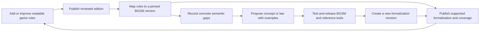

# RuleBooks: product and operating proposal

**Proposal 0.3.0 · 7 November 2026 · Product plan; see [operations](operations.md) for implemented automation and remaining setup.**

RuleBooks is a public library of game rules and the home of the Board Game Semantic Model (BGSM). People can learn a game's rules, inspect how those rules are represented, and discover what the model can and cannot yet express. Adding games improves the model; improving the model makes more games expressible. Neither activity waits for the other to be complete.

RuleBooks owns BGSM's specification, shared semantic libraries, conformance examples, and basic public compiler/interpreter tooling. It owns the game catalog and its published formalizations. Downstream products consume versioned releases; their implementation schedules and proprietary features are outside this proposal.

This is the selected product direction. Readable editions may have no formalization; executable definitions use compact source packages with exact semantic dependencies and derived machine artifacts.

## The product in one tree

```text
RuleBooks
├── Games
│   └── Game → RuleBooks rulebook revision (family and publisher edition where applicable)
│       ├── Readable rules, stable rule anchors and sources
│       ├── Formalizations: zero, one or several
│       │   ├── Exact BGSM and language versions
│       │   ├── Covered rules and known gaps
│       │   └── Source, compiled artifacts and verification evidence
│       └── Optional variants, procedures and interpretation notes
├── BGSM
│   └── Version → concepts, definitions, laws and examples
│       ├── Games using each concept
│       └── Gaps, proposals and changes between versions
└── Tools and releases
    ├── Basic compiler/interpreter and conformance suites
    └── Downloadable packages and capability-limited language adapters
```

The default game page answers “How do I play?” The semantics view answers “What does this rule mean formally, under which model, and what has been checked?” The BGSM view answers “What can this version express, and why does this concept exist?”

The common vocabulary gives people stable names before every name has executable semantics. A vocabulary term, a proposed semantic concept, and an implemented operation have different visible statuses. An encyclopedia entry must not accidentally become a language feature.

## The loop we are building



A gap is useful product data. It says “this rule needs simultaneous commitment” or “this model cannot express a history-sensitive right,” with an actual rule and counterexample attached. It does not prevent the readable edition from being useful. Conversely, discovering a gap does not automatically authorize a new primitive: first investigate whether existing concepts can express it, and whether the difficulty belongs in the notation, a library, an adapter, or BGSM itself.

## The first public version

Call the first usable product **RuleBooks 0.1**, independently of its BGSM version. Start with three readable game entries and a deliberately uneven level of formal support:

| Entry | Reader experience | Formalization target for launch |
|---|---|---|
| Chess | Reviewed rules for a clearly named edition/scope; complete reading path for that scope | Readable-only or partial, depending on demonstrated capabilities; coverage follows actual modeling work |
| Nim | Complete rules for a precisely defined normal-play configuration | One complete definition executable by the public reference implementation; bounded exhaustive conformance evidence |
| Rock-paper-scissors | Complete readable rules for a named baseline | Reference-only or partial; an explicit simultaneous-choice/information-boundary gap if unsupported |
| Coin-toss examples | Developer fixtures in the BGSM explorer | Exercise explicit chance in the planned reference language; not counted as full board-game coverage |

“Complete” always names a scope. A complete fixed-configuration Nim definition does not imply every Nim variant is covered. A chess mechanics guide does not claim to formalize all FIDE conduct, clock, event and tournament provisions.

Visitors can browse/search games and concepts, read rules and citations, switch between published versions, inspect supported semantics, see uncovered rules, download compact packages, and report a correction. Inspection includes named definitions, dependencies, source-to-rule links and saved test evidence. It does not require exposing a raw AST as the primary UI.

The planned initial editor workflow uses repository forms/templates, pull requests and generated previews. A dedicated editing UI follows a proven workflow; it writes the same change sets and passes the same checks. Public contributor accounts, an execution sandbox, advanced variant authoring and richer interpretation annotations may follow demonstrated demand. Live gameplay, actual events and playthrough storage remain outside RuleBooks. Reusable procedural or tournament definitions may be added when relevant.

An earlier catalog alpha can go online before Nim execution is ready, labeled accordingly. The first usable release includes the end-to-end formalization demonstration: otherwise we have tested a documentation site but not the central product loop.

## Architecture chosen for a small operating team

Start with one repository containing content, BGSM releases, basic tooling, tests and the site. Store authored data as small JSON manifests and readable Markdown/source files. Git is the initial system of record. Generate search indexes, public JSON, inspection views and static pages from validated releases.

Build and test on changes; serve the resulting files. Reading an old rulebook never invokes a compiler, resolves a mutable dependency, or requires a live editorial database. An interpreter change cannot take the public library offline merely because compilation now behaves differently. Historical execution support is a separate, explicit commitment.

Managed hosting with minimal maintenance is the confirmed deployment direction. Use a static site with a managed CDN. The [operations plan](operations.md) proposes Astro, the existing GitHub repository, CI and Cloudflare Pages. These are implementation choices, not part of the public data contract. A different host can serve the same release artifact.

## What will keep this manageable

1. **Optional formalization.** Games enter the library before BGSM catches up.
2. **Immutable pins.** New model versions create new formalizations; they do not rewrite the catalog.
3. **One authored semantic source per formalization.** Compiled JSON, diagrams and target-language exports are derived artifacts.
4. **Small current support surface.** One recommended BGSM line and one experimental line initially; archived content remains readable.
5. **Bounded contribution throughput.** Human review capacity determines how many AI and human editors work concurrently.
6. **Explicit ownership.** The initial maintainer owns product decisions, semantic acceptance and production releases; automation supplies checks and reports.

The largest ongoing cost is likely to be reviewing meaning, not serving files. More generated game entries do not solve that constraint. We should expand the contributor pool only after several editions can pass through intake, review, publication and correction without the maintainer reconstructing the author's work.

## How to use this proposal

| Document | Decision it makes concrete |
|---|---|
| [Data and versioning](data-and-versioning.md) | Small entities, canonical boundaries, independent versions and change rules |
| [Contribution workflow](contribution-workflow.md) | How humans and AI add games, expose gaps, review changes and evolve BGSM |
| [Implementation plan](implementation-plan.md) | Ordered work, deliverables and launch gates grounded in what exists |
| [Operations](operations.md) | Who deploys, monitors, restores, budgets and manages the service |
| [Repository and reference boundaries](repository-boundaries.md) | Open development, private source storage, publication checks and cleanup policy |

Publisher editions and RuleBooks revisions are separate identities: Dominion first and second editions are distinct games grouped for discovery; corrections to our descriptions only advance our own record revisions. The content wishlist and semantic gap queues are [versioned repository data](../../work/README.md), not a requirement to use an external issue tracker.

[Publication contract 0.1.0](../architecture/publication-contract.md) establishes the first schema and game-shaped test fixtures. The [publication assembler](../development/publication-assembly.md) now turns reviewed records into reproducible public data. The [Astro browsing slice](../development/site.md) consumes those outputs and includes a clearly labeled preview of actual collected rules while content acceptance proceeds. That gives us something inspectable before committing to broad language work or a large editorial UI.
