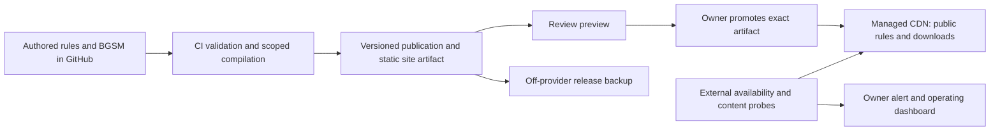

# Deployment, monitoring and product management

Part of [proposal 0.3.0](README.md). Managed hosting with minimal maintenance is the selected direction; Cloudflare Pages is the recommended host. Repository validation is implemented as described below. Hosting, deployment and monitoring remain planned.

## Setup sequence and current automation

The [repository validation workflow](../../.github/workflows/validate.yml) checks maintained paths and documentation links, product work records, credentials and publication contract/boundary tests on pull requests and pushes to `main`, with a manual run option. Contract tests cover fixture boundaries, exact references, attribution, coverage, digests and immutable history. The workflow uses a read-only repository token, no deployment secrets, pinned action commits and pinned dependencies/scanner. The [contribution-check guide](../development/contribution-checks.md) defines local review, exact-candidate verification and enforcement limits.

The workflow also builds the static Astro site and tests routes, stable anchors and downloads. It does not fetch external citations or enforce branch protection. Local pre-publication review remains required: CI runs after the triggering push has already disclosed its contents. Mandatory reviewers/repository rules and protected deployment promotion still need configuration before broader contributions and launch.

Set up delivery in stages:

1. **Now:** validate the repository, publication contracts and Astro build. Use the [local catalog](../development/site.md) to review readable game data.
2. **First buildable catalog slice:** create a Cloudflare Pages Direct Upload project and upload an approved static build as a preview. Use GitHub Actions to build the artifact; Cloudflare serves the prebuilt output. This does not require connecting Cloudflare's GitHub app to other repositories or organizations.
3. **Before public launch:** add artifact retention and digest verification, protected production promotion, the custom domain, smoke checks, rollback and external monitoring. Track this in [implementation issue #12](https://github.com/miralie-llc/rulebooks/issues/12). Promote the reviewed artifact without rebuilding it.

Cloudflare setup will require the intended account and domain, plus a deployment token restricted to the relevant Cloudflare account with Pages permissions. Store that token in the appropriate GitHub deployment environment; never put it in Git, work records or chat. Keep production credentials out of pull-request validation. Select any preview access controls before uploading material. [Cloudflare CI deployment documentation](https://developers.cloudflare.com/pages/how-to/use-direct-upload-with-continuous-integration/)

## Who does what

| Responsibility | Initially accountable | Automated assistance |
|---|---|---|
| Product scope and content priorities | Initial maintainer | Queue and coverage reports |
| Edition/source review | Initial maintainer, then designated game reviewers | Citation/reference checks and readable diffs |
| BGSM meaning and compatibility | Semantic maintainer | Conformance, affected-package reports and migration previews |
| Compiler/site engineering | Assigned developer, initially the project builder | CI checks and dependency update proposals |
| Production release and incident decisions | Release owner, with a backup operator designated before wider launch | Tested deployment job, smoke checks, failure alerts |
| Credentials, backups and spend | Initial maintainer | Backup jobs, restore reports and budget notifications |

These are responsibilities, not six hires. AI can prepare and check work but is not the accountable operator. If the release owner is unavailable, the last good static publication keeps serving; publishing can wait. The initial service has no promise of round-the-clock human response.

## Deployment shape

The project is intended to be open. Use the [repository/reference boundaries](repository-boundaries.md) to keep private research and credentials outside public Git. AI authoring is reviewed before a public branch, PR or preview is created. Public source and public website publication are separate gates. Private reference storage is outside both publication inputs. Product queues live in versioned `work/` records, with only reviewed projections selected for the site.

Recommended starting stack:

- **GitHub repository and CI:** this repository's current origin is GitHub. Keep content, code and model changes reviewable together; run a pinned build on changes.
- **Astro static site:** render local Markdown/JSON into game and model pages. Its build-time collections support this input pattern and static route generation. [Astro content collections](https://docs.astro.build/en/guides/content-collections/)
- **Cloudflare Pages, prebuilt deployment:** CI creates the release; Pages serves it. Direct Upload supports prebuilt assets and branch previews, so the same checked directory can be used for preview and production. Choosing Direct Upload means switching later to Git integration requires a new project. [Pages Direct Upload](https://developers.cloudflare.com/pages/get-started/direct-upload/)
- **External uptime checks and off-provider backup:** choose the specific services during setup. Keep these replaceable; a Git mirror alone is not a backup of separately stored artifacts or source captures.

No database, background compiler service or mandatory public login is needed for the first release. The basic reference compiler/interpreter runs in CI or locally. Add browser execution later only for explicitly supported, bounded inputs. Keep contributed rule text as data; do not allow executable MDX or arbitrary build scripts in ordinary content submissions.

## The release procedure

1. Before any public push, review candidate files and outgoing history and run local secret checks; private drafts stay outside public Git. Then validate the public-intended change without production credentials. Require review for semantic/content changes; separate review for code and workflow changes.
2. From a trusted reviewed commit, build with locked dependencies and exact semantic pins. Run checks and create the manifest, site files and downloadable artifacts. Record checksums and tool versions.
3. Deploy a preview and inspect changed rules, concepts, coverage, version links and downloadable data. Preview publication is itself disclosure: only approved-for-public material enters this pipeline. Pages previews are public by default; configure restricted preview access if needed. [Preview access controls](https://developers.cloudflare.com/pages/configuration/preview-deployments/)
4. The release owner or backup operator promotes that exact artifact using a protected release job. Verify its digest again; do not rebuild with newer dependencies. Record release ID, commit, checks and operator.
5. Run production smoke checks: game page, BGSM page, search, pinned manifest and one download digest. If they fail, restore the previous good production deployment and open a release incident.

Normal releases can be weekly approved batches; corrections can ship immediately. Publishing a BGSM release is independent of publishing a readable edition. A failed compiler job blocks the affected candidate, not the currently served site.

Every deployment includes the retained versioned records needed by its manifest. Old edition/artifact URLs stay valid in later publications. Once historical files outgrow a practical site build, move immutable downloads to object storage behind the same stable paths; do not redesign the content model. Keep current indexes/cache lifetimes short and content-addressed artifacts immutable. Clients follow one pinned publication manifest rather than fetching unrelated `latest` resources.

## Monitoring that catches useful failures

| Check | Proposed cadence/threshold | Owner action |
|---|---|---|
| Public availability plus known content marker | External probe every 5 minutes; alert after 3 consecutive failures | Check provider status, compare current release, rollback if release-related |
| Release integrity | Every deployment: manifest, selected edition, BGSM version and download hashes agree | Stop promotion or rollback; retain failed evidence |
| Build/conformance regressions | Every relevant change; full suite for semantic/tool releases | Assign code/content defect; never quietly weaken coverage status |
| Internal links and references | Every build | Block broken required references |
| External citation availability | Weekly, reported separately | Update locator or add archive reference; do not unpublish a valid edition just because a source server is down |
| Backup success | Daily report; alert on missed run | Restore backup job and assess unprotected changes |
| Review backlog, unresolved gaps and corrections | Weekly owner report | Limit intake, prioritize fixes and select next semantic capability |
| Usage, build duration and hosting/CI/storage/AI spend | Monthly review, provider budget alerts where available | Revisit budgets or pause bulk intake before cost surprises |

Initial service objectives are proposed operating targets, not contractual SLAs: 99.5% monthly reading availability; restore the last good site within 30 minutes of operator response; no more than 24 hours of unrecoverable unpublished work after a provider loss. Measure actual results before promising more. Expected unrepresented rules are product gaps, not uptime incidents.

Give every alert a named owner and a runbook link. Start with email to the owner and a simple dashboard when monitoring is configured. Add an alternate operator/contact before treating this as a depended-on external service.

## Failure and recovery

| Failure | Response |
|---|---|
| Broken UI or release manifest | Roll back to a known good production deployment, verify probes, fix in a new candidate |
| Wrong rule or misleading formalization | Remove recommendation/complete claim via a corrective publication, attach visible notice, publish corrected revision; keep unaffected reading content available |
| Compiler behavior changes unexpectedly | Stop new affected builds, retain existing publications, compare pinned implementations and fixtures; do not relabel old evidence as newly tested |
| Git/CI outage | Continue serving last release; resume editing/publication when available |
| Hosting account/provider loss | Restore archived static release on alternate host, verify checksums and switch DNS with the domain owner |
| Contributor credential compromise | Revoke access, inspect affected changes, rotate exposed secrets and redeploy known-good artifact if necessary |

Pages supports rollback to a previous successful **production** deployment; preview deployments are not rollback targets. Keep at least two known-good production releases and an independent copy of the artifacts. [Pages rollback documentation](https://developers.cloudflare.com/pages/configuration/rollbacks/)

An immediate site rollback may temporarily omit newly introduced version URLs. Restore any valid new immutable downloads in the corrective publication; record the incident rather than promising uninterrupted access to artifacts involved in a failed release. Withdrawal notices remain available even if rights or safety concerns require removal of the underlying payload.

Back up repository refs, publication manifests, built release files, permitted source archives, configuration-as-code and a credential-recovery inventory. Store sensitive captures separately with appropriate access. Back up daily and on each production release, outside the primary host/account. Target recovery of the public site within one business day after total provider loss. Rehearse restore before launch and quarterly; test a small backup sample monthly. DNS ownership and account recovery access belong in the operator handover.

## Routine workload and scaling triggers

Budget roughly an hour a week for operational checks and queue triage, plus a monthly maintenance/restore session. This excludes writing rules, semantic review and engineering, which are the substantive product work. If routine infrastructure repeatedly exceeds that budget, simplify it before adding services.

Set an initial infrastructure budget ceiling, for example $100/month excluding labor, domains and AI collection runs; this is a planning cap, not a vendor price estimate. Verify actual plans/quotas before provisioning. Give agent collection runs separate per-batch limits and stop conditions. Cached static serving makes increased readership a different problem from increased editing and compilation.

Add a richer editorial UI when nontechnical contribution friction is measured. Add a database when concurrent draft workflows, permissions or query needs exceed repository-backed editing, keeping immutable published packages as the public contract. Split build artifacts/storage when build time or file volume becomes problematic. Add maintainers when review latency remains high despite bounded assignments. None of these changes requires existing games to adopt a new BGSM.

The weekly management view should contain current production release, health, next approved batch, submissions waiting on review, oldest significant semantic gaps, latest corrections and spend. The product is managed through those queues and release decisions, rather than continuous manual supervision of interpreters.
